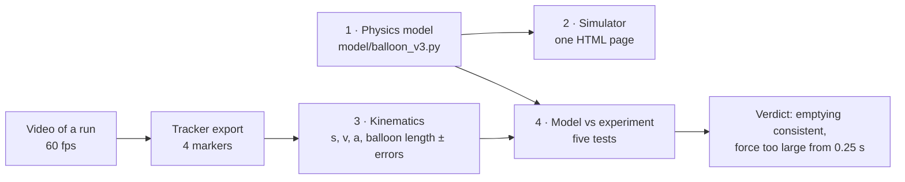

# Balloon rocket on a wire — physics model, simulator and video analysis

A balloon is taped to a straw threaded on a taut wire and released. The escaping air pushes it along the wire. This project:

1. **derives a physics model of the flight from first principles**: rubber elasticity → gas → nozzle flow → thrust → a variable-mass equation of motion with drag, added mass and friction;
2. **builds an interactive simulator** on that model, where you enter your own measurements and see the trajectory;
3. **measures a real flight** from video (Tracker), with honest error bars;
4. **tests the model against the video** and reports what agrees, what does not, and why.



## Results at a glance

**The model** has three coupled equations (position, speed, air left in the balloon). With its default inputs, most of which are placeholders, it predicts a 0.21 N peak thrust, a 4.8 s burn, an 11.3 m/s peak speed and a 39 m run. Every step is derived in [docs/01](docs/01-physics-model.md) and checked symbolically and numerically ([`tests/`](tests/)).

**The video** (0.83 s at 60 fps) shows the straw averaging 0.76 m/s and slowing slightly until about **t = 0.12 s**, even though the balloon is already losing air, so it is most likely still being held. From then on it accelerates: hard at first (about 17 m/s²), then more gently. It reaches 3.45 ± 0.06 m/s (±2σ) and 2.00 m, while the balloon shrinks from 24.2 cm to 13.0 cm long ([docs/03](docs/03-video-analysis.md)).

**Model vs video** ([docs/04](docs/04-model-vs-experiment.md)):

| Question | Answer |
| --- | --- |
| Does the balloon empty the way the model predicts? | **Consistent**, within the noise (χ²/dof = 1.11). This is a weak test, because a straight line fits almost as well |
| Does the motion have the model's shape over time? | **Broadly.** The fitted model follows the trend (rms miss 4.8 mm), but the misses are about 1.4 times the noise, and an early-calibrated model slightly overshoots the second half (−0.7σ to −2.1σ) |
| Are the forces the right size, with ordinary values for the unmeasured mass, drag, pressure and shape? | **At the start, possibly** (34–128 % of the model's thrust in the first 0.1 s). **From 0.25 s on, no:** the motion shows only 11–55 % of it. The model fits only with a hard-to-believe mass (16–70 g) and drag coefficient (2–4.3) |
| Is the start of the clip free flight? | **No.** The balloon was most likely still in the hand until about 0.12 s |


**Bottom line.** The video is consistent with how the model empties the balloon, and the motion has roughly the shape the model predicts. But the forces do not add up. From 0.25 s on, the model predicts 2–9 times more thrust than the motion shows. In the first ~0.1 s after the onset the balloon accelerates about as hard as the model says, so either the net force fades quickly or the start was a push from the hand. The moving mass, balloon pressure, neck size and balloon shape were never measured, and this single clip cannot separate them. So it cannot validate the force level or pinpoint the cause. [docs/04](docs/04-model-vs-experiment.md#what-would-settle-it) lists the checks that can still be made on the same video, and the measurements that would turn the comparison into a real validation.

## Repository layout

```text
balloon-rocket-physics/
├── model/
│   ├── balloon_v3.py            physics model (Python): equations, parameters, solver
│   └── make_guide_figures.py    figures for the physics guide
├── simulator/
│   ├── balloon-rocket-simulator.html   the interactive simulator: open in a browser
│   ├── src/                     engine.js (physics port), app.js, body.html, styles.css
│   └── build.py                 rebuilds the HTML from src/
├── analysis/
│   ├── data/tracker_export.csv  the raw Tracker export (4 markers, 51 frames)
│   ├── common.py                loading, noise model, error propagation, model wrappers, fitting
│   ├── 01_data_quality.py … 06_identifiability.py   the analysis, step by step
│   ├── run_all.py               runs every step (about 35 s)
│   └── results/                 every number quoted in the docs (JSON / CSV)
├── docs/
│   ├── 01-physics-model.md      complete derivation (17 sections)
│   ├── 02-simulator.md          what the simulator does and how it was verified
│   ├── 03-video-analysis.md     from Tracker data to velocity, acceleration and balloon size
│   ├── 04-model-vs-experiment.md   five tests, the verdict, and what to do next
│   └── figures/
├── tests/
│   ├── test_model.py            13 checks: symbolic derivations, budgets, regressions, convergence
│   ├── test_js_engine.js        browser engine against the Python model (9 cases)
│   └── make_js_reference.py
└── legacy/balloon_v2.py         previous version, kept for the regression test
```

## How to run

**Simulator:** download [`simulator/balloon-rocket-simulator.html`](simulator/balloon-rocket-simulator.html) and open it in any browser. It works offline and needs no installation.

**Analysis and tests** (Python 3.9 or later):

```text
pip install -r requirements.txt
python analysis/run_all.py                 # the whole video analysis; writes analysis/results and docs/figures
python tests/test_model.py                 # or: pytest tests/
python tests/make_js_reference.py && node tests/test_js_engine.js    # needs Node.js
```

## Reading order

1. [The physics model](docs/01-physics-model.md): assumptions, derivations, parameters, predictions, verification and limitations.
2. [The simulator](docs/02-simulator.md).
3. [The video analysis](docs/03-video-analysis.md).
4. [Model vs experiment](docs/04-model-vs-experiment.md).

## Main limitations

- Most model inputs (rubber constants, nozzle losses, mass, drag) are placeholders, not measurements.
- The video is a single 0.83 s clip from one camera view, with positions exported to 3 significant figures. The balloon is most likely still held for its first 0.12 s, and there is no coast phase, so wire friction and the drag floor cannot be determined from it.
- The model treats the balloon as a rigid sphere sliding on the wire, with quasi-steady flow through the neck.

## Credits

Tracker analysis:  The video was analysed with [Tracker](https://physlets.org/tracker/) (Open Source Physics). All numerical results can be reproduced from the code in this repository.

Licensed under the [MIT License](LICENSE).
