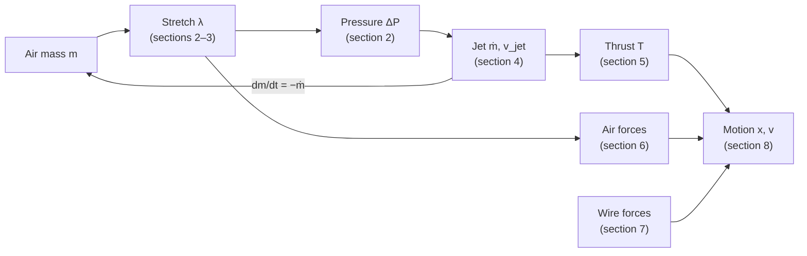
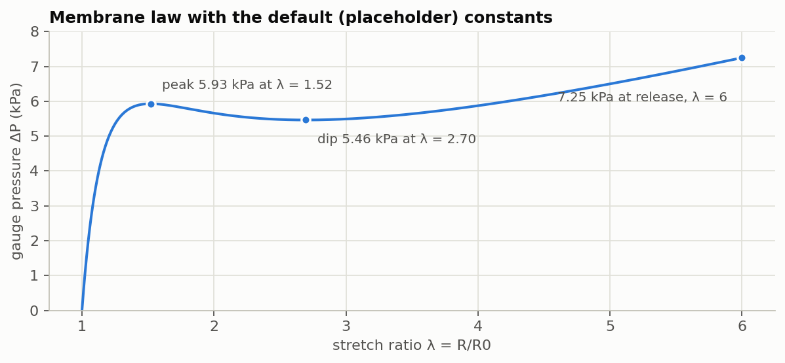
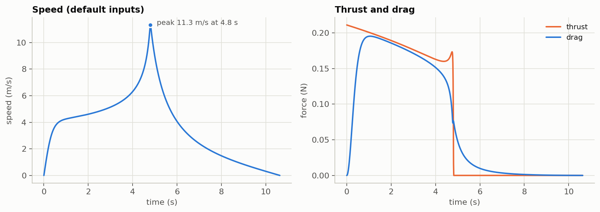

# 1 · The physics model, derived from first principles

> Part of [balloon-rocket-physics](../README.md). Code: [`model/balloon_v3.py`](../model/balloon_v3.py) · checks: [`tests/test_model.py`](../tests/test_model.py) · next: [2 · Simulator](02-simulator.md)

The simulator predicts how a balloon rocket moves along a guide wire by chaining five pieces of physics. Rubber elasticity sets the balloon pressure. The ideal-gas law sets how much air it holds. Nozzle flow turns pressure into a jet, momentum conservation turns the jet into thrust, and forces from the air and the wire decide the motion.

With the default inputs, most of which are uncalibrated placeholders, the model predicts 0.21 N peak thrust, a 4.8 s burn, 11.3 m/s peak speed and a 39 m run. This guide derives every equation behind those numbers, in the order the model uses them, and states every assumption and value.

## 1. The system and the assumptions

The model treats the balloon rocket as one rigid body sliding along a straight wire. Three numbers describe it at any moment: position x along the wire, velocity v, and the mass of air still in the balloon, m.

A latex balloon is inflated, taped to a straw threaded on a taut wire, and released. Air jets out of the neck, which acts as the nozzle, and pushes the balloon forward. The wire removes every motion except sliding along it.

```math
\mathbf{y}(t) = \begin{bmatrix} x \\ v \\ m \end{bmatrix}
```

Every other quantity (stretch, pressure, jet, drag, added mass) is a function of m alone. The chain below is the order in which the model, and this guide, builds them.



Air mass fixes the balloon's size and pressure. Pressure drives the jet, which both empties the balloon and pushes it, and the size sets how strongly the air resists.

The model rests on twelve assumptions:

- **A1 One body, one direction.** Balloon, tape and straw move as one rigid body along a straight wire, with no rotation, swinging or wire vibration.
- **A2 Spherical balloon.** The balloon stays a sphere and stretches uniformly, so one stretch ratio λ = R/R0 describes its shape.
- **A3 Ideal rubber.** The wall is a thin, incompressible, hyperelastic membrane with no hysteresis, creep or rate effects.
- **A4 Quasi-static wall.** The inertia of the rubber, and of the air it pushes aside as it shrinks, is neglected.
- **A5 Reservoir gas.** The air inside is an ideal gas at uniform pressure and temperature, essentially at rest.
- **A6 Thermal limits.** Heat exchange with the room is either complete (isothermal) or absent (adiabatic).
- **A7 Quasi-steady nozzle.** Flow through the neck is steady at each instant, one-dimensional and isentropic, corrected by two loss coefficients; the jet leaves at room pressure.
- **A8 Still room air.** The surrounding air is at rest, at uniform pressure and temperature.
- **A9 Drag.** A constant drag coefficient acts on the current frontal area, which never falls below a set minimum drag area.
- **A10 Added mass.** The surrounding air's inertia takes its ideal-flow value for a sphere whose size changes.
- **A11 Coulomb friction** acts between straw and wire.
- **A12 Aligned jet.** The jet axis passes through the centre of mass; an optional angle α tilts it away from the wire.

Section 16 lists every symbol. T alone always means thrust; temperatures always carry a subscript (T\_b, T\_amb, T\_0, T\_e).

## 2. Step 1 — The balloon membrane: from rubber to pressure

The stretched rubber sets the balloon's pressure. For a thin spherical Mooney–Rivlin balloon the gauge pressure is ΔP = 4(H0/R0)(1/λ − 1/λ⁷)(C1 + C2λ²), and this section derives it from the energy stored in the rubber.

### 2.1 Stretch and thickness

Take the unstretched balloon as a sphere of radius R0 with wall thickness H0 (w0 in the code). Inflated, its radius is R and its wall thickness h. The default λ0 = 6 means a 4 cm balloon blown up to 24 cm.

A thin sphere stretches equally in every direction along its surface. That gives two equal in-plane stretches and one through the thickness:

```math
\lambda_1 = \lambda_2 = \lambda = \frac{R}{R_0}, \qquad \lambda_3 = \frac{h}{H_0}
```

Rubber is nearly incompressible: its bulk modulus is thousands of times its shear modulus. Its volume is therefore conserved, which fixes the thickness:

```math
\lambda_1\lambda_2\lambda_3 = 1 \;\;\Rightarrow\;\; \lambda_3 = \frac{1}{\lambda^2}, \qquad h = \frac{H_0}{\lambda^2}, \qquad V_r = 4\pi R_0^2 H_0 = 4\pi R^2 h
```

At λ = 6 the 0.5 mm wall thins to 14 µm, while the rubber volume V\_r stays 2.51 cm³.

### 2.2 Stored energy

A hyperelastic material stores an energy W per unit of unstretched volume that depends only on the current stretch. For an isotropic, incompressible material, W depends on the stretches through two invariants:

```math
I_1 = \lambda_1^2 + \lambda_2^2 + \lambda_3^2 = 2\lambda^2 + \lambda^{-4}, \qquad I_2 = \lambda_1^2\lambda_2^2 + \lambda_2^2\lambda_3^2 + \lambda_3^2\lambda_1^2 = \lambda^4 + 2\lambda^{-2}
```

The Mooney–Rivlin model keeps the lowest-order term in each invariant:

```math
W = C_1\,(I_1 - 3) + C_2\,(I_2 - 3)
```

Both terms vanish at λ = 1, so unstretched rubber stores nothing. Setting C2 = 0 gives the neo-Hookean model, and at small strain the shear modulus is μ = 2(C1 + C2).

### 2.3 Pressure from an energy balance

Inflate the balloon slowly by a small volume dV. The net pressure ΔP = P\_b − P\_atm does work ΔP·dV, and all of it is stored in the rubber:

```math
\Delta P\,dV = V_r\,dW \quad\Rightarrow\quad \Delta P = V_r\,\frac{dW/d\lambda}{dV/d\lambda}
```

The two derivatives are:

```math
V = \tfrac{4}{3}\pi R_0^3\lambda^3, \qquad \frac{dV}{d\lambda} = 4\pi R_0^3\lambda^2
```

```math
\frac{dW}{d\lambda} = C_1\,(4\lambda - 4\lambda^{-5}) + C_2\,(4\lambda^3 - 4\lambda^{-3}) = 4\,(\lambda - \lambda^{-5})\,(C_1 + C_2\lambda^2)
```

Substituting gives the membrane law the code uses:

```math
\Delta P(\lambda) = \frac{4H_0}{R_0}\left(\frac{1}{\lambda} - \frac{1}{\lambda^7}\right)\left(C_1 + C_2\lambda^2\right)
```

The prefactor 4 (k\_pressure in the code) is exact for constants defined as in W. Texts written with the shear modulus use 2μ(H0/R0)(1/λ − 1/λ⁷), which is the same law when C2 = 0.

### 2.4 Cross-check with Laplace's law

Force balance gives the same law. Cut the balloon in half: pressure on the disc πR² balances the wall tension around the rim 2πR.

```math
\Delta P\,\pi R^2 = \sigma h \cdot 2\pi R \quad\Rightarrow\quad \Delta P = \frac{2\sigma h}{R}
```

For equibiaxial stretch the true (Cauchy) wall stress is σ = (λ/2)·dW/dλ. The ½ appears because one change in λ stretches both in-plane directions at once.

```math
\sigma = \frac{\lambda}{2}\frac{dW}{d\lambda} = 2\,(\lambda^2 - \lambda^{-4})\,(C_1 + C_2\lambda^2)
```

With h = H0/λ² and R = λR0, 2σh/R reproduces the membrane law exactly.

### 2.5 Shape of the pressure curve

The pressure does not rise steadily with stretch. The early peak is why a balloon is hard to start blowing up, and the dip after it is why it then gets easier.



*Membrane law with the default constants (made by [`model/make_guide_figures.py`](../model/make_guide_figures.py)).*

With the default constants the pressure peaks at 5.93 kPa (λ = 1.52), dips to 5.46 kPa (λ = 2.70) and rises to 7.25 kPa at release (λ = 6). In the neo-Hookean case, setting d(1/λ − 1/λ⁷)/dλ = 0 puts the peak at λ = 7^(1/6) = 1.38. The C2 term is what makes the pressure climb again at large stretch.

### 2.6 Where this law falls short

The Mooney–Rivlin law is the weakest link in the model. Real latex departs from it in four ways:

- **Hysteresis:** measured deflation curves lie below inflation curves, and deflation is what drives the rocket ([Vandermarlière 2016](https://physlab.org/wp-content/uploads/2023/01/1.4967901.pdf)).
- **Softening:** a balloon inflated once is softer the next time (the Mullins effect), and it creeps while held inflated.
- **Stiffening:** at large stretch the rubber chains near full extension and crystallize, so pressure rises faster than the model predicts.
- **Shape:** most party balloons are not spheres.

The code can therefore replace the law with a measured deflation curve, pv\_data = (V, ΔP). Size then comes from the sphere of equal volume:

```math
R_{eq} = \left(\frac{3V}{4\pi}\right)^{1/3}
```

The defaults C1 = 75 kPa and C2 = 10 kPa are placeholders chosen to give a few kPa of pressure. They are not fitted to a real balloon.

## 3. Step 2 — The air inside the balloon

The ideal-gas law turns the balloon's size and pressure into the mass of air it holds, m = P\_b V/(R\_air T\_b). That mass is the quantity the model tracks.

The air inside moves slowly everywhere except at the neck, so it is treated as a uniform reservoir at rest. Its absolute pressure is atmospheric plus the membrane pressure:

```math
m = \frac{P_b\,V}{R_{air}\,T_b}, \qquad P_b = P_{atm} + \Delta P(\lambda), \qquad V = \tfrac{4}{3}\pi(\lambda R_0)^3
```

The gas constant of air is R\_air = R\_u/M\_air = 8.314/0.028965 = 287.05 J/(kg·K). Absolute pressure is essential here: using the gauge pressure alone would make the air mass 15 to 20 times too small.

At release (λ0 = 6) the balloon holds V0 = 7.24 L at P\_b = 108.6 kPa, 7.2 % above atmospheric, so m0 = 9.28 g. The flow stops at λ = 1, where ΔP = 0. The limp balloon still holds 33.5 cm³ at atmospheric pressure (0.040 g), so 9.24 g of air is usable.

### 3.1 Turning mass back into stretch

The model tracks m, so it must recover λ from m. That needs m to rise steadily with λ. For isothermal gas:

```math
\frac{dm}{dV} = \frac{1}{R_{air}T_b}\left(P_b + V\,\frac{d\Delta P}{dV}\right) > 0
```

Where pressure falls with volume, V·dΔP/dV reaches only −422 Pa, tiny next to P\_b ≈ 10⁵ Pa. So m(λ) always increases and the inversion is unique. The code checks this for either thermal model and stops with an error otherwise.

### 3.2 Temperature: two limits

Two limits bound the gas temperature. In the isothermal limit, the default, heat flows in fast enough to hold T\_b = T\_amb. In the adiabatic limit no heat flows, and the air left behind expands reversibly as its neighbours leave.

For a closed parcel with no heat exchange, the first law and the gas law combine as below (v\_s = 1/ρ is the specific volume, and c\_p − c\_v = R\_air):

```math
c_v\,dT = -P\,dv_s, \quad P\,v_s = R_{air}T \;\;\Rightarrow\;\; c_p\,dT = v_s\,dP \;\;\Rightarrow\;\; \frac{dT}{T} = \frac{\gamma-1}{\gamma}\,\frac{dP}{P}
```

Integrating from release, when the gas is at room temperature:

```math
T_b = T_{amb}\left(\frac{P_b}{P_{b,0}}\right)^{(\gamma-1)/\gamma}, \qquad \gamma = \frac{c_p}{c_v} = 1.4
```

As the pressure falls from 108.6 kPa to atmospheric, the adiabatic gas cools by 5.8 K. The two limits change every result by 0.2 % or less, so the choice hardly matters. To first order thrust depends on pressure, not temperature (section 4).

### 3.3 Density of the room air

The same law fixes the density of the surrounding air: ρ\_a = P\_atm/(R\_air T\_amb) = 1.197 kg/m³ at 101.325 kPa and 295 K. The code derives it rather than taking a separate value, so density, pressure and temperature cannot contradict each other. The familiar 1.225 kg/m³ belongs to 15 °C.

The air inside is slightly denser, ρ\_b = P\_b/(R\_air T\_b) = 1.282 kg/m³ at release.

## 4. Step 3 — Flow through the nozzle

Treating the neck as a short nozzle with steady, frictionless, adiabatic flow gives the jet speed and mass flow; two loss coefficients then correct them. At release the real jet leaves at 102 m/s (about Mach 0.3) and carries 2.06 g/s.

### 4.1 Why the flow can be treated as steady

Air crosses a few centimetres of neck in about 0.3 ms, while the balloon empties over about 5 s. At each instant the nozzle therefore sees a steady flow fed by the current balloon state. That state is the reservoir (stagnation) condition: P\_0 = P\_b and T\_0 = T\_b.

### 4.2 Jet speed from the energy equation

Follow the air from the balloon, where it is nearly at rest, to the exit plane. With no heat or work exchanged, the steady-flow energy equation keeps the stagnation enthalpy constant:

```math
c_p T_0 = c_p T_e + \tfrac{1}{2}v_e^2 \quad\Rightarrow\quad v_e^2 = 2c_p\,(T_0 - T_e)
```

Without friction the expansion is isentropic, which ties exit temperature and density to the pressure ratio r = p\_e/P\_0:

```math
\frac{T_e}{T_0} = r^{(\gamma-1)/\gamma}, \qquad \frac{\rho_e}{\rho_0} = r^{1/\gamma}, \qquad \rho_0 = \frac{P_0}{R_{air}T_0}, \qquad c_p = \frac{\gamma R_{air}}{\gamma-1}
```

Substituting gives the ideal jet speed:

```math
v_e = \sqrt{\frac{2\gamma}{\gamma-1}\,R_{air}T_0\left[1 - r^{(\gamma-1)/\gamma}\right]}
```

### 4.3 Mass flow

Mass flow is density × speed × area at the exit, with A\_e = πD²/4 (19.6 mm² for D = 5 mm):

```math
\dot m = \rho_e v_e A_e = A_e P_0\sqrt{\frac{2\gamma}{(\gamma-1)R_{air}T_0}\left[r^{2/\gamma} - r^{(\gamma+1)/\gamma}\right]}
```

The second form follows from ρ\_e = ρ\_0 r^(1/γ) and the jet-speed formula. The powers of r combine because r^(2/γ) × r^((γ−1)/γ) = r^((γ+1)/γ).

### 4.4 Exit pressure and the subsonic check

A subsonic jet leaves at the pressure around it, so p\_e = P\_atm and r = P\_atm/P\_b. The flow would choke, reaching Mach 1 at the exit, only if the pressure ratio exceeded:

```math
\left(\frac{P_0}{p_e}\right)_{crit} = \left(\frac{\gamma+1}{2}\right)^{\gamma/(\gamma-1)} = 1.893
```

The balloon never exceeds 1.072, so the jet is always subsonic. The code still clips r at the critical value, a guard that never activates here. The exit Mach number at release is:

```math
M_e = \sqrt{\frac{2}{\gamma-1}\left[\left(\frac{P_0}{p_e}\right)^{(\gamma-1)/\gamma} - 1\right]} = 0.316
```

### 4.5 The incompressible limit

For small ΔP/P\_0 these formulas reduce to Bernoulli's equation:

```math
v_e \approx \sqrt{\frac{2\Delta P}{\rho_0}}, \qquad \dot m \approx A_e\sqrt{2\rho_0\,\Delta P}, \qquad \dot m\,v_e \approx 2A_e\,\Delta P
```

At release Bernoulli gives 106.3 m/s and 0.285 N of ideal thrust. The compressible formulas give 107.7 m/s and 0.278 N, so compressibility trims thrust by 2.5 %. The code keeps the exact form because it costs nothing.

### 4.6 Real nozzles: loss coefficients

A real nozzle delivers less than the ideal. Three standard coefficients describe how:

- **Velocity coefficient C\_v:** actual jet speed ÷ ideal, lowered by wall friction and an uneven velocity profile.
- **Contraction coefficient C\_c:** area of the jet at its narrowest point (the vena contracta) ÷ A\_e.
- **Discharge coefficient C\_d:** actual mass flow ÷ ideal, equal to C\_c × C\_v.

```math
\dot m_{real} = C_d\,\dot m, \qquad v_{jet} = C_v\,v_e, \qquad T = \dot m_{real}\,v_{jet} = C_d C_v\,\dot m\,v_e, \qquad C_c = \frac{C_d}{C_v} \le 1
```

The thrust T = ṁ\_real v\_jet is derived in section 5. The defaults C\_d = 0.80 and C\_v = 0.95 imply C\_c = 0.84 and a thrust factor of 0.76. The code rejects C\_d > C\_v, which would need a jet wider than the hole.

At release these give v\_jet = 102.3 m/s, ṁ\_real = 2.06 g/s and T = 0.211 N.

### 4.7 If the air leaves through a straw

Flow fills a straw, so C\_c ≈ 1 and C\_d ≈ C\_v, and pipe friction sets the loss. Bernoulli with loss terms, ΔP = ½ρv²(1 + K\_entry + fL/D), gives:

```math
C_v \approx \frac{1}{\sqrt{1 + K_{entry} + f\,L/D}}, \qquad f \approx 0.3164\,Re^{-1/4}\;\;(\text{Blasius, smooth pipe})
```

Take D = 5 mm, L = 17.5 cm and v ≈ 100 m/s. Then Re = vD/ν ≈ 3.3 × 10⁴, f = 0.024 and fL/D = 0.82. With K\_entry ≈ 0.5 this gives C\_v ≈ 0.66, so a long straw costs about a third of the jet speed.

## 5. Step 4 — Thrust and the equation of motion

Momentum conservation for a body that throws mass backwards gives M dv/dt = ṁ\_real v\_jet + ΣF. The thrust is therefore T = ṁ\_real v\_jet, with v\_jet measured relative to the balloon, and no extra v·dM/dt term appears.

### 5.1 Momentum balance over a short time

Let M = m\_e + m be the moving mass: rubber, tape and straw (m\_e) plus the air inside, which travels with the balloon. In a short time dt the balloon ejects a parcel of mass ṁ\_real dt. Relative to the balloon the parcel moves backwards at v\_jet, so relative to the ground it moves at v − v\_jet. Meanwhile the external forces along the wire deliver an impulse ΣF dt.

```math
\underbrace{M v}_{\text{before}} + \Sigma F\,dt = \underbrace{(M - \dot m_{real}\,dt)(v + dv)}_{\text{balloon after}} + \underbrace{\dot m_{real}\,dt\,(v - v_{jet})}_{\text{ejected parcel}}
```

Expand, cancel Mv and the two ṁ\_real v dt terms, and drop the second-order term ṁ\_real dt dv:

```math
M\,\frac{dv}{dt} = \dot m_{real}\,v_{jet} + \Sigma F, \qquad T = \dot m_{real}\,v_{jet}
```

The v terms cancel because the parcel leaves carrying the balloon's own forward speed. Writing T + ΣF = d(Mv)/dt instead would be wrong: that law assumes the lost mass ends up at rest in the ground frame.

### 5.2 The pressure term

The general thrust formula has a second term:

```math
T = \dot m_{real}\,v_{jet} + (p_e - P_{atm})\,A_e
```

It arises when the pressure in the exit plane differs from the room pressure acting on the rest of the body. A subsonic jet exits at room pressure (section 4.4), so here this term is zero.

### 5.3 Two easy mistakes

- **Relative speed:** v\_jet must be the jet speed relative to the balloon, which is exactly what the nozzle formulas give.
- **Inside air:** M must include the air inside, 9.28 g at release, which is more than the 5 g of rubber, tape and straw.

The same result follows from the Reynolds transport theorem applied to a control volume that moves with the balloon.

## 6. Step 5 — Forces from the surrounding air

The still room air acts on the balloon in three separate ways: it buoys it up, it drags on it, and it has to be pushed aside, which adds inertia. Drag dominates: over a flight it absorbs 92 % of the thrust impulse.

### 6.1 Buoyancy

Room pressure rises with depth (dp/dz = −ρ\_a g). Summed over the balloon's closed surface, it gives Archimedes' upthrust ρ\_a V g. This force is vertical, so on a level wire it only changes how hard the straw presses down. The net weight is:

```math
W_{net} = (M - \rho_a V)\,g = (m_e + m - \rho_a V)\,g
```

At release the balloon weighs 0.140 N, and the 8.66 g of displaced air cancels 0.085 N, leaving W\_net = 0.055 N. The air inside is nearly weightless: for isothermal gas, m/(ρ\_a V) = P\_b/P\_atm = 1.072.

Buoyancy does not reduce inertia. The inside air must still be accelerated, so its 9.28 g stays in M. W\_net is always positive for an air-filled balloon, because the inside air is denser than the room air and the rubber adds weight.

### 6.2 Drag

Air resistance on a blunt body grows with the square of speed:

```math
F_D = \tfrac{1}{2}\,\rho_a\,C_D\,A\,v\,|v|, \qquad A = \pi R^2 = \pi(\lambda R_0)^2
```

Writing v|v| instead of v² keeps drag opposed to motion if v ever turns negative. The drag coefficient depends on the Reynolds number Re = ρ\_a v(2R)/μ\_air, with μ\_air = 1.82 × 10⁻⁵ Pa·s. For most of the burn Re is 3 × 10⁴ to 6 × 10⁴. A smooth sphere in this range has C\_D ≈ 0.47, well below the drag crisis near Re ≈ 3 × 10⁵, so C\_D is held constant.

When drag balances thrust the balloon moves at its terminal speed, which it approaches on a time scale τ:

```math
v_t = \sqrt{\frac{2T}{\rho_a C_D A}}, \qquad \tau \approx \frac{m_{eff}\,v_t}{T}
```

For the full-size balloon (A = 0.045 m², T = 0.211 N), v\_t = 4.07 m/s and τ ≈ 0.36 s. As the balloon shrinks, A falls as λ² while T changes little, so v\_t rises roughly as 1/λ. This one fact explains the shape of the velocity curve in section 11.

A nearly empty balloon is a limp bag rather than a small sphere, and the straw and tape add drag of their own. The code therefore never lets the drag area fall below (C\_DA)min = 1.0 × 10⁻³ m²:

```math
F_D = \tfrac{1}{2}\,\rho_a\,\max\!\left(C_D\pi R^2,\;(C_DA)_{min}\right)v\,|v|
```

The floor takes over below λ ≈ 1.30. It is a heuristic placeholder that matters mainly during the coast.

### 6.3 Added mass of a shrinking sphere

To move, the balloon must also set the air around it in motion. Ideal (potential) flow gives this effect exactly for a sphere. For a sphere of radius R(t) moving at speed U(t), the flow potential is a dipole plus a source (a sink while the balloon shrinks):

```math
\phi(r,\theta,t) = -\frac{U R^3}{2r^2}\cos\theta \;-\; \frac{R^2\dot R}{r}
```

On the surface r = R it gives the radial velocity U cos θ + Ṙ, matching the moving, shrinking wall, and it vanishes far away. For a sphere of fixed size, the kinetic energy of this flow is ½ m\_a U², with:

```math
m_a = C_{add}\,\rho_a V, \qquad C_{add} = \tfrac{1}{2}
```

The force comes from integrating the unsteady Bernoulli pressure over the moving surface:

```math
p = p_\infty - \rho_a\left(\frac{\partial\phi}{\partial t}\bigg|_{\text{fixed point}} + \tfrac{1}{2}|\nabla\phi|^2\right), \qquad F_x = -\oint p\,n_x\,dS
```

Two details matter. The time derivative is taken at a fixed point in space, which differs from the derivative in coordinates moving with the sphere by the term −U ∂φ/∂x. And the cross terms between dipole and source survive the integration. The result, checked symbolically (section 12), is:

```math
F_{am} = -\frac{d}{dt}\left(\tfrac{1}{2}\rho_a V U\right) = -\tfrac{1}{2}\rho_a V\,\frac{dU}{dt} \;-\; \tfrac{1}{2}\rho_a U\,\frac{dV}{dt}
```

The first term resists acceleration, so it moves to the left of the equation of motion as extra inertia: m\_eff = M + m\_a. The second term exists only for a body that changes size. While the balloon shrinks (dV/dt < 0) it pushes forward, because the surrounding air returns momentum it was given earlier. Weymouth and Triantafyllou (2013) call this added-mass recovery.

In the code U = v, and dV/dt comes from the lookup tables:

```math
F_{amr} = -C_{add}\,\rho_a\,v\,\frac{dV}{dt}, \qquad \frac{dV}{dt} = -\frac{dV}{dm}\,\dot m_{real}
```

Over a flight that starts and ends at rest, the added-mass force delivers exactly zero net impulse:

```math
\int_0^{t_{end}} F_{am}\,dt = -\Big[\tfrac{1}{2}\rho_a V v\Big]_0^{t_{end}} = 0 \qquad \text{because } v(0) = v(t_{end}) = 0
```

So added mass delays the balloon but costs no momentum overall. At release it adds 4.33 g to 14.28 g, 30 % more inertia, which cuts the initial acceleration from 14.8 to 11.3 m/s².

Two caveats apply. The ideal-flow value ignores the separated wake behind the balloon and the jet itself. And for a 2:1 elongated balloon moving along its axis, C\_add is about 0.21 instead of 0.5.

## 7. Step 6 — Forces from the wire

The wire carries the balloon's net weight and any sideways thrust, and Coulomb friction on that load opposes the motion. With the defaults friction is only 2.8 mN, about 1 % of peak thrust, but it largely decides how far the balloon coasts.

### 7.1 The load on the wire

On a wire inclined at angle θ, the net weight splits into a component along the wire, W\_net sin θ, and a component pressing on it, W\_net cos θ. If the jet points at angle α to the wire, only T cos α drives the balloon, and T sin α pushes the straw sideways. Taking that sideways push as horizontal, the two loads add at right angles:

```math
N = \sqrt{(W_{net}\cos\theta)^2 + (T\sin\alpha)^2}
```

If the tilt were in the vertical plane, the two loads would add or subtract directly. The right-angle form is a modelling choice.

### 7.2 Coulomb friction

While sliding, friction is μ\_k N against the motion. At rest the straw holds until the driving force beats static friction μ\_s N:

```math
F_f = \begin{cases} \mu_k N\,\operatorname{sign}(v), & v \neq 0 \\ \text{held, } dv/dt = 0, & v = 0,\ |F_{drive}| \le \mu_s N \\ \mu_k N\,\operatorname{sign}(F_{drive}), & v = 0,\ |F_{drive}| > \mu_s N \end{cases}
```

The driving force is F\_drive = T cos α − W\_net sin θ + F\_amr. At release the thrust, 0.211 N, is about fifty times the static limit μ\_s N = 0.0044 N, so the balloon always starts. The run ends at the first stop, so a balloon on a steep slope is never allowed to slide back.

### 7.3 Why an offset jet does not jam the straw

The jet usually sits several centimetres below the wire, which looks as if it should rock the straw and jam it. It does not, as long as the jet axis passes through the centre of mass G. Thrust, drag and the added-mass force all act along that axis, and the inertial force M·a acts at G, so none of them has a moment about G. The straw only has to react the small moment of friction itself.

A jet tilted by α is different: it creates a real sideways load, which the model includes through N.

### 7.4 Slope

Along a sloping wire, gravity adds −W\_net sin θ. Because the air inside nearly floats, W\_net is small, so slope matters mainly during the long coast. A 5° upward slope shortens the run from 39.1 m to 34.6 m.

## 8. The complete model

Sections 2–7 combine into three first-order differential equations in x, v and m. Every coefficient depends on m alone, apart from the explicit v in drag, friction and added-mass recovery.

```math
\begin{aligned}
\frac{dx}{dt} &= v \\[6pt]
\frac{dv}{dt} &= \frac{T\cos\alpha \;-\; F_D \;-\; F_f \;-\; W_{net}\sin\theta \;+\; F_{amr}}{m_{eff}} \\[6pt]
\frac{dm}{dt} &= -\dot m_{real}
\end{aligned}
```

Each term, and the section that derives it:

| Term | Expression | Section |
| --- | --- | --- |
| Stretch | λ from m, by inverting m = P\_b V/(R\_air T\_b) | 3 |
| Pressure | ΔP = 4(H0/R0)(1/λ − 1/λ⁷)(C1 + C2λ²) | 2 |
| Mass flow | ṁ\_real = C\_d × isentropic ṁ(P\_b, T\_b) | 4 |
| Thrust | T = ṁ\_real v\_jet, with v\_jet = C\_v v\_e | 4, 5 |
| Drag | F\_D = ½ρ\_a max(C\_DπR², (C\_DA)min) v\|v\| | 6.2 |
| Net weight | W\_net = (m\_e + m − ρ\_a V) g | 6.1 |
| Inertia | m\_eff = m\_e + m + C\_add ρ\_a V | 5, 6.3 |
| Added-mass recovery | F\_amr = C\_add ρ\_a v (dV/dm) ṁ\_real | 6.3 |
| Wire load | N = √((W\_net cos θ)² + (T sin α)²) | 7.1 |
| Friction | F\_f = μ\_k N sign(v), with a static check at rest | 7.2 |

The balloon starts at rest and fully inflated:

```math
x(0) = 0, \qquad v(0) = 0, \qquad m(0) = m(\lambda_0) = 9.28\ \text{g}
```

The run stops when v falls back through zero, meaning the balloon has stopped, or when x reaches the usable wire length L\_wire.

### 8.1 How the burn ends

The burn ends by itself. Near λ = 1 the membrane law gives ΔP ≈ 24(H0/R0)(C1 + C2)(λ − 1), so ΔP falls to zero. Mass flow scales as √ΔP, so dm/dt ∝ −√(m − m\_min) and the balloon empties in finite time, like a draining tank. The last 0.040 g of air stays inside.

### 8.2 Lookup tables

Because everything depends on m, the code evaluates the chain once, on 6000 values of λ from 1 to λ0. It stores m, R, V, ΔP, T\_b, ṁ\_real, v\_jet and dV/dm, then interpolates linearly in m during the integration. This avoids solving for λ inside every time step. With a measured pv\_data curve, the same tables are built on V instead of λ.

## 9. Solving it numerically

The code integrates the three equations with SciPy's adaptive Runge–Kutta method and locates the stopping moment exactly. Refining the lookup table or tightening the tolerances changes no reported digit.

- **Integrator:** solve\_ivp with RK45 (Dormand–Prince), a fifth-order step whose fourth-order companion estimates the error and sets the step size.
- **Tolerances:** relative 10⁻⁸, absolute 10⁻¹⁰, and a maximum step of 0.01 s. The step cap stops the solver striding over the end of the burn, when λ falls from 3 to 1 in 0.6 s.
- **Interpolation:** linear interpolation keeps the right-hand side continuous, with small kinks at table nodes that the adaptive step control absorbs.
- **Events:** the solver finds the moment v crosses zero from above, or x reaches L\_wire, by root-finding on its dense output. That exact time is appended to the results, so final values are not limited by the output grid.
- **Burn time:** reported as the last moment thrust exceeds 2 % of its peak.

| Numerical setting | Final distance | Peak speed | Burn time |
| --- | --- | --- | --- |
| Default: 6000-point table, rtol 10⁻⁸, max step 0.01 s | 39.1250 m | 11.3188 m/s | 4.8108 s |
| 30,000-point table | 39.1250 m | 11.3188 m/s | 4.8108 s |
| rtol 10⁻¹⁰, atol 10⁻¹², max step 0.002 s | 39.1250 m | 11.3188 m/s | 4.8108 s |

The numerical error is therefore far below the physical uncertainty in the inputs (section 13).

## 10. Parameter values

Only the physical constants and the two exact coefficients (k = 4, C\_add = 0.5 for a sphere) are trustworthy as they stand. The geometry, the rubber constants, the nozzle losses, the drag floor and the friction coefficients are placeholders to be measured (section 15).

| Symbol | Code name | Default | What it is | Status |
| --- | --- | --- | --- | --- |
| m\_e | m\_empty | 5 g | Rubber, tape and straw | Placeholder: weigh it |
| R0 | R0 | 20 mm | Unstretched radius | Placeholder: measure |
| H0 | w0 | 0.5 mm | Unstretched wall thickness | Placeholder: measure |
| D | D\_nozzle | 5 mm | Air-exit diameter (A\_e = 19.6 mm²) | Placeholder: measure |
| λ0 | lam0 | 6 | Stretch at release (24 cm balloon) | Placeholder: measure circumference |
| k | k\_pressure | 4 | Membrane-law prefactor | Exact (section 2.3) |
| C1 | C1 | 75 kPa | Mooney–Rivlin constant | Placeholder: fit a P–V test |
| C2 | C2 | 10 kPa | Mooney–Rivlin constant | Placeholder: fit a P–V test |
| — | pv\_data | none | Measured deflation curve (V, ΔP) | Replaces C1, C2 when given |
| P\_atm | P\_atm | 101.325 kPa | Room pressure | Sea-level standard; set to site |
| T\_amb | T\_amb | 295 K (22 °C) | Room temperature | Set to site |
| γ | gamma | 1.4 | Heat-capacity ratio of air | Physical constant |
| R\_air | R\_air | 287.05 J/(kg·K) | Gas constant of air | Physical constant |
| ρ\_a | rho\_air | 1.197 kg/m³ | Room-air density | Derived: P\_atm/(R\_air T\_amb) |
| — | thermal | isothermal | Gas temperature model | Bounding case; adiabatic differs by ≤ 0.2 % |
| C\_d | Cd | 0.80 | Discharge coefficient | Placeholder: burn-time test |
| C\_v | Cv | 0.95 | Velocity coefficient | Placeholder: static-thrust test |
| C\_D | C\_D | 0.47 | Drag coefficient | Smooth sphere at Re 10³–10⁵; shape-dependent |
| (C\_DA)min | CdA\_min | 1.0 × 10⁻³ m² | Drag-area floor | Heuristic placeholder: flight video |
| C\_add | C\_add | 0.5 | Added-mass coefficient | Exact for a sphere in ideal flow |
| μ\_k | mu\_k | 0.05 | Kinetic friction, straw on wire | Placeholder: flight video |
| μ\_s | mu\_s | 0.08 | Static friction | Placeholder |
| g | g | 9.81 m/s² | Gravity | Constant |
| θ | theta\_deg | 0° | Wire slope, positive uphill | Measure the setup |
| α | misalign\_deg | 0° | Jet angle to the wire | Measure the setup |
| L\_wire | L\_wire | unlimited | Usable wire length | Set to the setup |

Four switches, all on by default, turn physics off for testing: use\_buoyancy, use\_added\_mass, use\_added\_mass\_rate and friction\_opposes\_motion. Numerical settings are in section 9.

## 11. What the model predicts

With the default inputs the balloon reaches 4 m/s within half a second and cruises while drag nearly equals thrust. It surges to 11.3 m/s in the last 0.6 s of the burn, then coasts to a stop at 39.1 m after 10.6 s.

| Result | Value |
| --- | --- |
| Peak thrust | 0.211 N, at release |
| Burn time (thrust above 2 % of peak) | 4.81 s |
| Peak speed | 11.32 m/s at 4.80 s, when λ = 1.08 |
| Distance at burnout | 24.5 m |
| Final distance | 39.1 m, at 10.63 s |
| Time to cover the first 5 m | 1.43 s |



*Simulated with `balloon_v3.py`, default inputs, 0 to 10.63 s.*

### 11.1 The four phases of a flight

| Phase | Time | What happens | Distance |
| --- | --- | --- | --- |
| Launch | 0–0.5 s | Accelerates at up to 11.3 m/s² to 90 % of the 4.07 m/s terminal speed | 1.1 m |
| Cruise | 0.5–4.2 s | Drag nearly equals thrust; speed creeps from 3.7 to 6.8 m/s as λ falls from 5.8 to 3.0 | 18.2 m |
| Final squeeze | 4.2–4.8 s | λ falls from 3 to 1.1; drag area shrinks about five-fold while ΔP stays near 5.5–5.9 kPa, so speed jumps to 11.3 m/s | 5.1 m |
| Coast | 4.8–10.6 s | No thrust; drag and friction bring the balloon to rest | 14.7 m |

The final squeeze is the model's least trustworthy feature. It exists because the Mooney–Rivlin curve holds about 6 kPa until the balloon is almost empty. Real latex deflates along a lower curve (section 2.6), so a real balloon probably surges less.

### 11.2 Where the thrust impulse goes

Thrust delivers 0.884 N·s over the burn. Because the balloon starts and ends at rest, all of it must be absorbed by the other forces or carried away:

| Destination | Impulse | Share of thrust |
| --- | --- | --- |
| Drag | 0.811 N·s | 91.7 % |
| Forward momentum carried off in the exhaust | 0.046 N·s | 5.3 % |
| Wire friction | 0.027 N·s | 3.0 % |
| Added mass, net over the flight | 0.000 N·s | 0 % |

The exhaust term needs a word. Each parcel of air leaves carrying the balloon's forward speed v, so ∫ṁ\_real v dt of forward momentum leaves with it. Integrating the equation of motion from rest to rest, with zero net added-mass impulse, gives exactly this balance:

```math
\int_0^{t_{end}} T\,dt = \int_0^{t_{end}} F_D\,dt + \int_0^{t_{end}} F_f\,dt + \int_0^{t_{end}} \dot m_{real}\,v\,dt
```

The simulated numbers close to within 0.0001 N·s. Only 0.32 J of kinetic energy reaches the balloon at peak speed, under 1 % of the 45.5 J stored in the stretched rubber.

## 12. Verification

Each step was checked in at least one independent way, and every check passes. The symbolic checks used SymPy; the numerical checks ran the model itself. All of them are automated in [`tests/test_model.py`](../tests/test_model.py).

| Check | How | Result |
| --- | --- | --- |
| Membrane law | Energy-balance result minus the section 2.3 formula, simplified symbolically | Exactly zero |
| Membrane law, second route | Laplace's law with the Cauchy wall stress | Identical formula |
| Energy identity | ∫ΔP dV from λ = 1 to 6 against V\_r W(λ0) | 45.5 J and 45.5 J |
| Added-mass force | Surface integral of the unsteady Bernoulli pressure on a moving, shrinking sphere | F = −½ρ\_a d(VU)/dt exactly |
| Nozzle formulas | Compressible result against the Bernoulli limit | 2.5 % apart, as expected at Mach 0.32 |
| Momentum budget | Thrust impulse against drag, friction and exhaust momentum | Closes within 0.0001 N·s |
| Added-mass impulse | Numerical integral over a flight | 0.0000 N·s, as derived |
| Regression | v3 run with v2's settings, against v2 | Largest difference 4 µm/s, from interpolation |
| Measured-curve path | Mooney–Rivlin curve fed back in as pv\_data | Same results to four significant figures |
| Friction direction | 20° uphill wire | Stops at 29.5 m; speed never goes negative |
| Input guard | C\_d set above C\_v | Rejected with an error |
| Numerical convergence | Finer table, tighter tolerances (section 9) | No change in reported digits |
| Browser engine | The simulator's JavaScript port against this model, 9 test cases | Agree within 0.06 % ([`tests/test_js_engine.js`](../tests/test_js_engine.js)) |

### 12.1 Hand estimates against the model

Back-of-envelope numbers from the formulas above land within a few percent of the simulation:

| Quantity | Hand estimate | Model |
| --- | --- | --- |
| Thrust at release | 2 C\_d C\_v A\_e ΔP0 = 0.216 N | 0.211 N (compressibility −2.5 %) |
| Mass flow | C\_d A\_e √(2ρ\_b ΔP) at ΔP ≈ 6 kPa = 1.95 g/s | 1.92 g/s averaged over the burn |
| Burn time | 9.24 g ÷ 1.95 g/s = 4.7 s | 4.81 s |
| Initial acceleration | T/m\_eff = 0.211 N ÷ 18.6 g = 11.3 m/s² | 11.3 m/s² |
| Early cruise speed | v\_t = √(2T/(ρ\_a C\_D A)) = 4.07 m/s | 4.25 m/s at 1 s, when the balloon is already smaller |

## 13. Sensitivity

The balloon's size at release decides the final distance, while the nozzle and the pressure level decide the peak speed. The added-mass coefficient and friction barely move the speed.

Each number is an elasticity: the percentage change in an output for a 1 % increase in the input. They come from +20 % steps around the defaults (−5 % for C\_d and C\_v).

| Input | Peak speed | Final distance | Time to 5 m |
| --- | --- | --- | --- |
| R0, unstretched radius | −0.60 | +1.33 | +1.71 |
| λ0, stretch at release | 0.00 | +1.56 | +0.78 |
| D, nozzle diameter | +0.79 | −0.39 | −0.88 |
| C\_v, velocity coefficient | +0.61 | +0.47 | −0.50 |
| C\_d, discharge coefficient | +0.44 | −0.25 | −0.55 |
| H0, wall thickness (scales pressure) | +0.48 | +0.14 | −0.42 |
| C2, Mooney–Rivlin constant | +0.17 | +0.07 | −0.35 |
| C\_D, drag coefficient | −0.34 | −0.33 | +0.31 |
| C1, Mooney–Rivlin constant | +0.32 | +0.07 | −0.09 |
| (C\_DA)min, drag floor | −0.04 | −0.24 | 0.00 |
| m\_e, empty mass | −0.20 | +0.18 | +0.05 |
| μ\_k, friction | −0.01 | −0.10 | +0.01 |
| C\_add, added mass | +0.02 | +0.01 | +0.03 |

Four patterns stand out:

- **Size at release** matters most for distance, because it sets the air supply, which grows as (λ0 R0)³.
- **A wider nozzle** raises peak speed but shortens the run: it spends the air while the balloon is still large and draggy.
- **A heavier balloon** accelerates less but coasts further, because it carries more momentum per unit of drag.
- **C\_add** hardly matters, because the added-mass force returns the momentum it borrows (section 6.3).

Friction looks unimportant at this small step, but large changes matter. Raising μ\_k from 0.05 to 0.3 cuts the final distance from 39.1 m to 30.9 m, most of it during the coast.

## 14. Effects left out, and how small they are

Each effect below was estimated and shifts the driving pressure, the forces or the results by less than 1 %, so the model leaves it out.

| Effect | Estimate | Compared with |
| --- | --- | --- |
| Inertia of the rubber, and of the air it pushes aside while shrinking | Under 1 Pa | ΔP ≈ 6 kPa |
| Pressure difference across the accelerating balloon | ρ\_b a D ≈ 1.28 × 11.3 × 0.24 ≈ 3.5 Pa | ΔP ≈ 6 kPa |
| Hydrostatic pressure difference inside the balloon | ρ\_b g D ≈ 3 Pa | ΔP ≈ 6 kPa |
| Jet leaving into the low-pressure wake | About 0.3 × ½ρ\_a v² ≈ 22 Pa at 11 m/s | ΔP ≈ 6 kPa |
| Choked flow | Needs P\_b/P\_atm = 1.89 | At most 1.07 here |
| Unsteady flow in the nozzle | Transit time ≈ 0.3 ms | Burn ≈ 5 s |
| Humidity and CO₂ in breath-inflated air | Gas constant shifts by under 1 % | Thrust depends on ΔP, not R\_air, to first order |

## 15. Limitations and how to calibrate

The equations are sound, but most input numbers are not measured yet, and five real effects cannot be predicted from first principles. Five measurements and one validation run would pin them down.

### 15.1 What the model cannot represent

- **Rubber behaviour:** hysteresis, softening after the first inflation, creep and large-stretch stiffening. A measured deflation curve (pv\_data) captures all four.
- **The neck:** a latex neck is a collapsible tube that flutters (the raspberry noise) and changes its open area. The model lumps this into C\_d and C\_v.
- **Drag:** a sphere's C\_D is applied to a balloon that may be elongated, flattens at speed and trails a jet. The drag floor is a guess.
- **The wire:** friction depends on straw, wire, tension and alignment, and a sagging wire changes its slope along the path.
- **One degree of freedom:** the model has no pitching, rolling or swinging about the wire.

### 15.2 Calibration, step by step

1. **Geometry and mass.** Weigh balloon, straw and tape together (m\_e). Measure the unstretched diameter and wall thickness (R0, H0), the neck bore (D), and the inflated circumference, which gives λ0 = circumference ÷ 2πR0.
2. **Deflation pressure curve.** Connect the balloon to a water U-tube manometer: 1 cm of water is 98 Pa, so 7 kPa is about 71 cm. Let it deflate in steps, recording pressure and circumference each time, then pass the table to pv\_data or fit C1 and C2.
3. **Static thrust.** Clamp the inflated balloon on a kitchen scale with the jet pointing up, and tare with the neck pinched. On release, the extra reading is the thrust: 21 g on the scale is 0.21 N. Dividing by the ideal thrust from section 4 (about 2A\_eΔP), with ΔP read at the same moment, gives C\_d C\_v.
4. **Mass flow.** Time a full deflation, or film the circumference shrinking, to get ṁ\_real and hence C\_d. Then C\_v = (C\_d C\_v) ÷ C\_d.
5. **Flight video.** Film a run along a measured wire with a scale in view. Fit C\_D, (C\_DA)min and μ\_k to the measured x(t): launch and cruise constrain C\_D, and the coast constrains μ\_k and the floor. What our own 0.8 s clip could and could not determine is worked out in [4 · Model vs experiment](04-model-vs-experiment.md).
6. **Validation.** Predict a different setup, such as another inflation level or nozzle, before running it, then compare.

## 16. Symbols

| Symbol | Meaning | Unit |
| --- | --- | --- |
| t, x, v | Time, position along the wire, velocity | s, m, m/s |
| m, m\_min | Air mass in the balloon; air left when empty | kg |
| m\_e | Mass of rubber, tape and straw | kg |
| M | Moving mass, m\_e + m | kg |
| m\_a, m\_eff | Added mass; effective inertia M + m\_a | kg |
| R0, R, R\_eq | Unstretched radius; current radius; equal-volume radius | m |
| H0, h | Unstretched and current wall thickness | m |
| λ, λ0 | Stretch ratio R/R0; its value at release | — |
| λ1, λ2, λ3 | Principal stretches (two in-plane, one through the wall) | — |
| I1, I2 | Strain invariants | — |
| W | Stored energy per unit of unstretched rubber volume | J/m³ |
| C1, C2, μ | Mooney–Rivlin constants; small-strain shear modulus | Pa |
| σ | True (Cauchy) stress in the wall | Pa |
| V, V\_r | Balloon volume; rubber volume | m³ |
| ΔP | Gauge pressure inside the balloon | Pa |
| P\_b, P\_atm | Absolute pressure inside; room pressure | Pa |
| T\_b, T\_amb | Gas temperature inside; room temperature | K |
| P\_0, T\_0, ρ\_0 | Reservoir (stagnation) state feeding the nozzle | Pa, K, kg/m³ |
| p\_e, T\_e, ρ\_e | State in the exit plane | Pa, K, kg/m³ |
| r | Pressure ratio p\_e/P\_0 | — |
| R\_air, γ | Gas constant of air; heat-capacity ratio c\_p/c\_v | J/(kg·K), — |
| c\_p, c\_v | Specific heats at constant pressure and volume | J/(kg·K) |
| ρ\_a, ρ\_b | Density of room air; of the air inside | kg/m³ |
| D, A\_e | Exit diameter; exit area | m, m² |
| v\_e, v\_jet | Ideal jet speed; real jet speed C\_v v\_e | m/s |
| ṁ, ṁ\_real | Ideal mass flow; real mass flow C\_d ṁ | kg/s |
| M\_e | Exit Mach number | — |
| C\_d, C\_v, C\_c | Discharge, velocity and contraction coefficients | — |
| f, K\_entry | Pipe friction factor; entry loss coefficient | — |
| T | Thrust | N |
| F\_D, C\_D, A | Drag force; drag coefficient; frontal area | N, —, m² |
| (C\_DA)min | Minimum drag area | m² |
| Re, μ\_air, ν | Reynolds number; viscosity and kinematic viscosity of air | —, Pa·s, m²/s |
| v\_t, τ | Terminal speed; time to approach it | m/s, s |
| C\_add | Added-mass coefficient | — |
| F\_am, F\_amr | Added-mass force; its size-change (recovery) part | N |
| φ, U | Flow potential; sphere speed (U = v) | m²/s, m/s |
| W\_net | Net weight: weight minus buoyancy | N |
| N, F\_f | Normal load on the wire; friction force | N |
| μ\_k, μ\_s | Kinetic and static friction coefficients | — |
| F\_drive | Thrust along the wire, minus gravity along it, plus F\_amr | N |
| θ, α | Wire slope; jet angle to the wire (degrees in the code) | rad |
| g | Gravitational acceleration | m/s² |

## 17. Sources

- [Vandermarlière, "On the inflation of a rubber balloon", The Physics Teacher 54, 566 (2016)](https://physlab.org/wp-content/uploads/2023/01/1.4967901.pdf): the Mooney–Rivlin balloon law, measured hysteresis between inflation and deflation, and stiffening at large stretch.
- [Weymouth and Triantafyllou, "Ultra-fast escape of a deformable jet-propelled body", Journal of Fluid Mechanics (2013)](https://eprints.soton.ac.uk/349868): added-mass recovery by a shrinking, jet-propelled body.
- Standard textbook results, used from general knowledge rather than looked up for this guide: hyperelasticity and thin-shell inflation, isentropic nozzle flow, potential flow and added mass of a sphere, sphere drag, and the Blasius friction factor.
- The model itself, balloon\_v3.py, which produced every simulated number in this guide.
