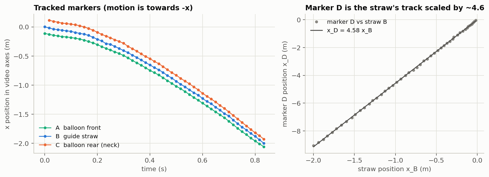
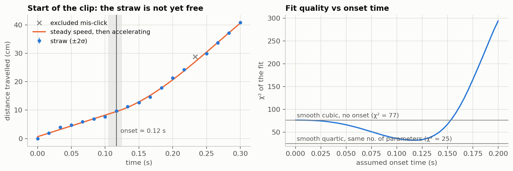
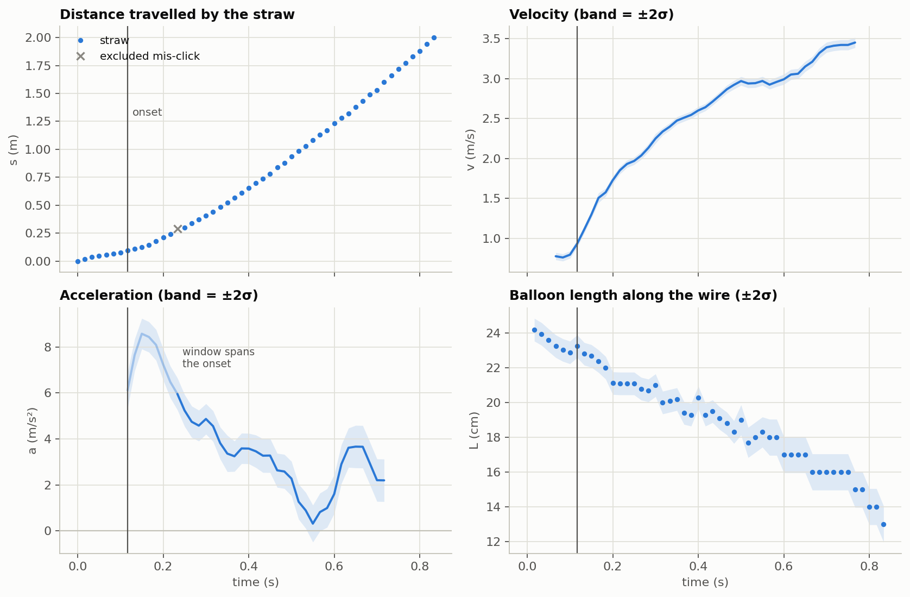

# 3 · The video: from Tracker data to kinematics

> Part of [balloon-rocket-physics](../README.md). Previous: [2 · Simulator](02-simulator.md) · next: [4 · Model vs experiment](04-model-vs-experiment.md)
> Code: [`analysis/01_data_quality.py`](../analysis/01_data_quality.py), [`analysis/02_kinematics.py`](../analysis/02_kinematics.py) · data: [`analysis/data/tracker_export.csv`](../analysis/data/tracker_export.csv)

## What was recorded

One run of the balloon rocket was filmed and tracked frame by frame in the [Tracker](https://physlets.org/tracker/) video-analysis program. The export holds four point tracks (`mass_A` to `mass_D`), with time and x, y positions in metres from Tracker's calibration. It covers 0 to 0.833 s, which is 51 frames.

Along the wire, A always leads the motion, C always trails it, and B always lies between them. We therefore take A as the **front of the balloon**, C as its **rear (neck) end** and B as the **guide straw**. This is an interpretation of the track order, so check it against the video. The balloon moves towards −x in the video's axes. The analysis uses:

- **s(t)**, the distance travelled by the straw (B), for the motion;
- **L(t) = x_C − x_A**, the balloon's length along the wire, for the deflation.

## Step 1 — Can the data be trusted?

| Check | Finding | Consequence |
| --- | --- | --- |
| Time base | Every exported time stamp is reproduced exactly by k/60 s, and by no other common rate | Exact frame times t = k/60 are used. This only shows that Tracker used 1/60 s per frame. Whether the phone recorded in **slow motion** must be checked separately, because it would rescale every time |
| Alignment | A and B start at frame 0, C and D at frame 1 | Markers are matched by frame number. Matching by spreadsheet row would shift the A–C midpoint by up to 30 mm |
| Geometry | B lies between A and C on every frame | A, B and C are consistent with one another |
| Marker D | x_D = 4.575 x_B, to within 0.3 % of its range. D moves 4.5–5.4 times as far as the straw it should travel with | No point on the balloon can do that, so the track is mis-scaled (probably a calibration problem in that track). **D is excluded** |
| Precision | Values were exported with 3 significant figures, so positions are rounded to 1 mm below 1 m and to **1 cm above 1 m** (19 of the 51 straw points) | Rounding adds an error of step/√12 (2.9 mm above 1 m). It is included in every error bar |
| Tracking noise | Robust estimate from third differences: A 1.6 mm, **B 2.9 mm**, C 2.8 mm | Total error per straw point: 3.0 mm below 1 m, 4.1 mm above |
| Mis-clicks | Straw frame 14 (t = 0.233 s) is 17.5 mm from the midpoint of its neighbours, 4.8 standard errors (the cut-off is 4.5). The largest deviation of any other frame of A, B or C is 3.0 (C, frame 18), which is normal for about 150 tracked points | Frame 14 of the straw is **excluded** from every fit. Putting it back changes the fitted values only slightly ([part 4](04-model-vs-experiment.md#test-2--does-the-motion-have-the-right-shape)) |
| Wire slope | The straw's height varies by 19 mm over 2 m, with a best-fit slope of +0.03° | The wire is treated as level (in the camera's frame) |

*Left: the three consistent tracks. Right: marker D is the straw's track scaled by about 4.6, so it is excluded.*

**How the noise was estimated.** For a smooth path sampled every 1/60 s, the third difference x[k+3] − 3x[k+2] + 3x[k+1] − x[k] is almost pure noise. The motion itself contributes about 0.1 mm here, and about 1 mm just after the onset. For independent errors of size σ, the variance of the third difference is 20σ². The spread is measured with the **median absolute deviation** rather than the standard deviation, so that a single mis-click cannot inflate it. With the ordinary standard deviation, frame 14 alone raises the straw estimate from 2.6 mm to 4.5 mm. The robust estimate is 2.9 mm. Only the part of each track rounded to 1 mm or better is used, and the rounding variance is subtracted.

## Step 2 — Velocity, acceleration and balloon size, with error bars

**Method.** Velocity and acceleration come from local quadratic least-squares fits (a Savitzky–Golay-type method) over 9 frames (0.15 s) and 15 frames (0.25 s). Each frame is weighted by its error, and the excluded frame is skipped. Each estimate is a linear combination of the positions, so its standard error follows exactly from the fit. Estimates are reported only where the whole window lies inside the data, so nothing is extrapolated at the ends of the clip.

### The start of the clip: not yet free flight

For the first ~0.12 s the straw averages **0.76 m/s and is not speeding up; it is slowing slightly**. A quadratic fit to those frames gives −8.6 ± 2.3 m/s², and extrapolated to the onset its speed is 0.55 ± 0.16 m/s. Yet the balloon is already shrinking, so air is leaving it. A free balloon that is losing air would accelerate forward, so something was still holding it back. Most likely the hand was still releasing it: **check the first ~7 frames of the video.** Then the straw starts to accelerate hard, at 17.2 ± 2.0 m/s².

A "steady speed, then accelerating" fit puts this **onset at t ≈ 0.12 s** (68 % range 0.104–0.125 s). A smooth curve with no onset does much worse (χ² = 77 against 33). A smooth quartic with the same number of parameters fits as well (χ² = 25), so the data show a rapid change but cannot say whether it was abrupt. The comparison with the free-flight model starts at **t = 0.12 s**, and [part 4](04-model-vs-experiment.md) checks that moving this anywhere from 0.10 to 0.15 s changes nothing important.

### Kinematics

*Bands are ±2σ. Faded part of the acceleration curve: the 0.25 s window still spans the onset, so it mixes the motion before and after it. Crosses mark the excluded frame.*

| Quantity | Value (±2σ) |
| --- | --- |
| Distance covered in 0.833 s | 2.00 m |
| Speed before the onset | averages 0.76 ± 0.06 m/s while slowing; 0.55 ± 0.32 m/s at the onset |
| Acceleration in the first 0.1 s after the onset (frames 8–13) | 17 ± 10 m/s² |
| Acceleration at 0.25 s | 5.2 ± 0.7 m/s² |
| Acceleration at 0.32–0.45 s | 4.6 → 3.3 ± 0.7 m/s² |
| Acceleration at 0.52–0.58 s | 0.3–1.3 ± 0.8 m/s² (a dip, lowest at 0.55 s) |
| Acceleration at 0.65 s / 0.72 s | 3.7 ± 0.9 / 2.2 ± 0.9 m/s² |
| Speed at t = 0.767 s (last full window) | 3.45 ± 0.06 m/s |
| Balloon length | 24.2 cm (frame 1) → 13.0 cm (end), ± 0.7 cm |

**What the video shows.** After the onset the straw accelerates hard for about a tenth of a second, then more gently, and it is still accelerating at the end of the clip. Its acceleration generally falls as the speed rises, with one clear dip around 0.55 s that then recovers. That dip is larger than the measurement noise can explain. It may be a real disturbance (for example the straw snagging on the wire) or a local tracking problem, and this clip cannot tell which. Over the clip the balloon loses about 46 % of its length, or roughly 84 % of its volume if its shape stays the same.

> **A pitfall worth knowing.** An earlier, quick version of this analysis concluded that the acceleration fell to zero at about 0.5 s and stayed there, which would mean the thrust ended early. That conclusion was wrong. Smoothing filters extrapolate at the ends of a record and produced a spurious flat tail near zero. On top of that, the dip described above was read as a trend. With error bars, and with no estimates at the ends, the dip is short and the acceleration recovers.

## What the video cannot provide

The video gives positions and lengths along one direction. It cannot give the moving **mass**, the balloon's **pressure** or rubber properties, the **neck (nozzle) diameter**, or the balloon's **width and full shape** (one camera view along the wire). These are exactly the quantities that set the size of the forces, and [4 · Model vs experiment](04-model-vs-experiment.md) works around them with explicit scenarios.

The balloon's width *could* be measured from the same video with Tracker's tape measure, if the camera saw the balloon side-on. That would pin down one of the unknowns (the shape scenarios in part 4).
