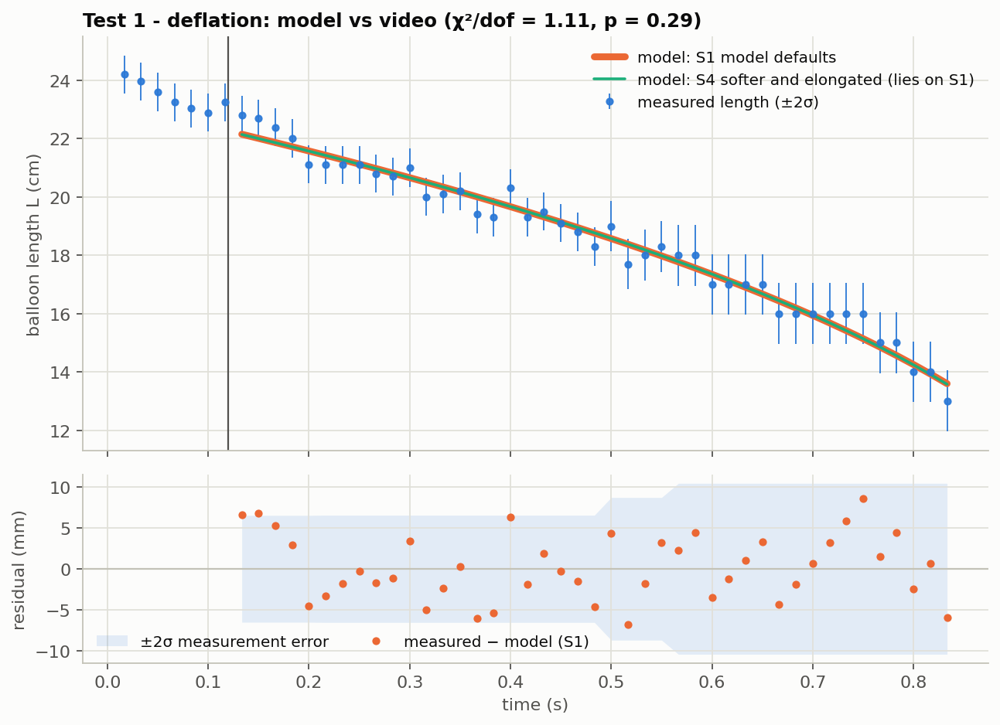
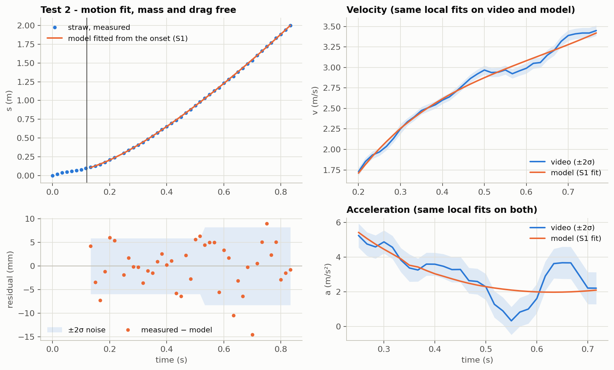
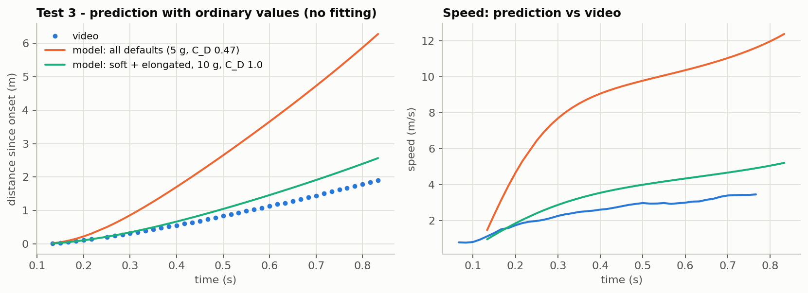
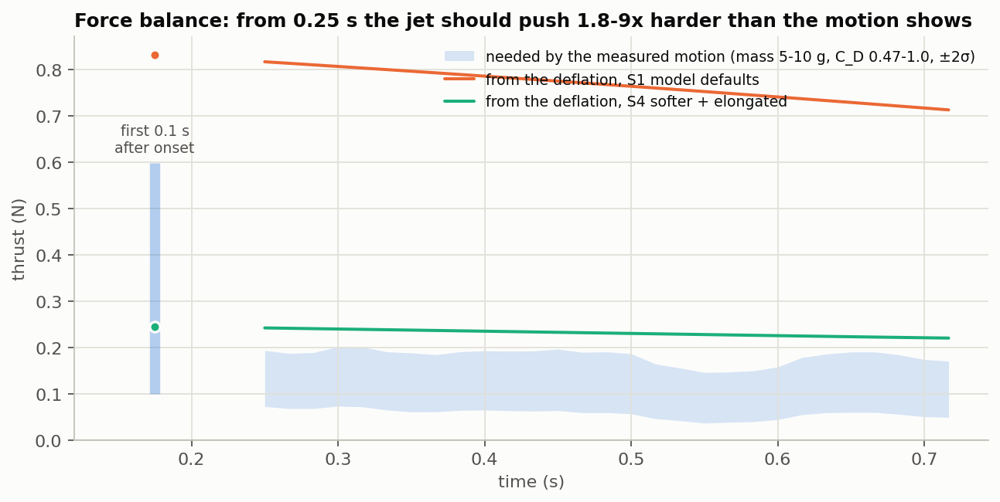
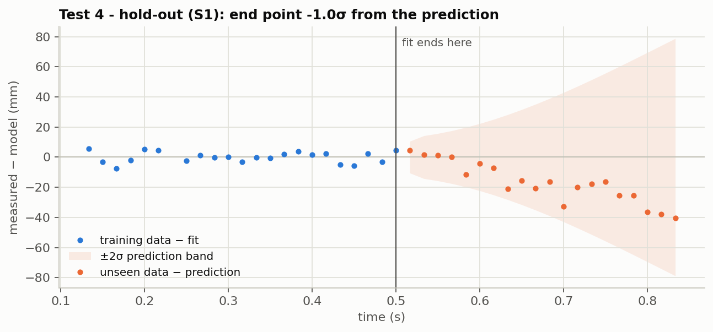
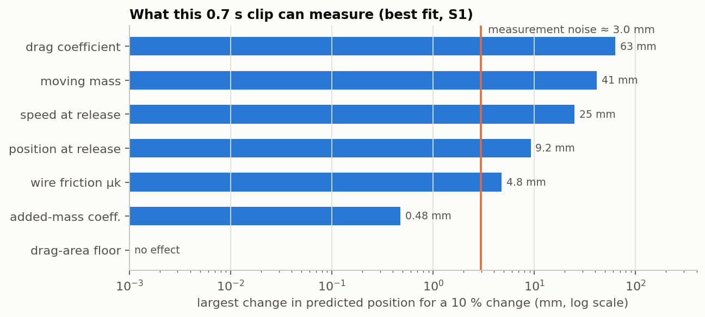

# 4 · Model vs experiment: does the video agree with the physics?

> Part of [balloon-rocket-physics](../README.md). Previous: [3 · Video analysis](03-video-analysis.md)
> Code: [`analysis/03_deflation_test.py`](../analysis/03_deflation_test.py) … [`06_identifiability.py`](../analysis/06_identifiability.py) · numbers: [`analysis/results/`](../analysis/results/)

## The question, and what one clip can answer

The model ([part 1](01-physics-model.md)) predicts two things that the video measures independently:

1. **How the balloon empties.** The rubber sets the pressure, and the pressure pushes air out through the neck. The video shows this as the balloon's length L(t).
2. **How the balloon moves.** The jet's thrust works against the moving mass, drag and friction. The video shows this as the straw's distance s(t).

Agreement in *shape* (how things change over time) and agreement in *size* (whether the forces have the right magnitude) are different claims, and the tests below keep them apart. A fit that matches the data closely is not by itself a validation. With enough free parameters almost any smooth curve can be matched, so every fitted value is also checked for physical sense.

**Statistics used.** Every fit is a weighted least-squares fit using the per-point errors of [part 3](03-video-analysis.md#step-1--can-the-data-be-trusted). Three numbers summarise each one:

- **χ²/dof** close to 1 means the misses are the size of the measurement noise.
- **p** is how often noise alone would give a misfit at least this large if the model were exactly right.
- **Runs test z**: residuals that change sign too rarely (z well below 0) reveal a systematic pattern even when χ² looks fine.

Where χ²/dof > 1, the quoted ± values are scaled up by √(χ²/dof).

## Connecting the model to the clip

The clip starts mid-flight, so the model is started at the **onset of acceleration, t = 0.12 s** ([part 3](03-video-analysis.md#the-start-of-the-clip-not-yet-free-flight)), with the straw's position x₀ and speed v₀ at that instant. The model treats the balloon as a sphere, and the measured length is converted to the **sphere of equal volume**. For a balloon whose length is e times its width:

```math
d_{eq} = L\,e^{-2/3}, \qquad \lambda_0 = \frac{d_{eq}(t_{onset})}{2R_0}, \qquad L_{model}(t) = 2R_0\,\lambda(t)\,e^{2/3}
```

Four quantities that set the *size* of the thrust were never measured: the rubber's stiffness, the balloon's shape, the moving mass and the drag coefficient. The first two are spanned by four example scenarios. These are choices made to show how much they matter, not measurements:

| Scenario | Rubber pressure | Shape (length : width) |
| --- | --- | --- |
| **S1** Model defaults | placeholder Mooney–Rivlin constants | sphere |
| **S2** Softer rubber | 0.3 × S1 | sphere |
| **S3** Elongated balloon | as S1 | 1.3 : 1 |
| **S4** Softer and elongated | 0.3 × S1 | 1.3 : 1 |

Everything else stays at the model defaults: C_d = 0.80, C_v = 0.95, C_add = 0.5, μ_k = 0.05, room air at 295 K and 101.3 kPa, and a level wire.

## Test 1 — Does the balloon empty the way the model says?

The deflation does not depend on the motion, so it is tested on its own. Two numbers are fitted to L(t) after the onset: the balloon's size at the onset and the **effective neck diameter** (strictly, C_d × neck area; C_d is fixed at 0.8). The *shape* of L(t) is then a prediction of the rubber law and the nozzle flow.



| Scenario | Neck diameter | χ²/dof (p) | Runs z | Pressure during the clip | Air inside at the onset | Air out |
| --- | --- | --- | --- | --- | --- | --- |
| S1 | 10.2 ± 0.1 mm | 45.6/41 (0.29) | −0.8 | 6.9 → 5.6 kPa | 7.4 g | 8.0 g/s |
| S2 | 13.5 ± 0.2 mm | 45.4/41 (0.29) | −0.8 | 2.1 → 1.7 kPa | 7.1 g | 7.6 g/s |
| S3 | 8.0 ± 0.1 mm | 46.0/41 (0.27) | −0.8 | 6.3 → 5.5 kPa | 4.3 g | 4.7 g/s |
| S4 | 10.5 ± 0.1 mm | 45.8/41 (0.28) | −0.8 | 1.9 → 1.6 kPa | 4.2 g | 4.5 g/s |

**Result: consistent, but a weak test.** After the onset the model reproduces the measured shrinking to within the measurement noise (rms miss 4.0 mm, no residual pattern), with an effective neck diameter of 8–14 mm (the neck itself was not measured). The test cannot do more than that, though. A plain straight line in time fits almost as well (χ² = 48.6 against 45.6), and all four scenarios fit equally well. Over 0.7 s the shrinking is close to steady, so it cannot single out the model's particular rubber law.

Before the onset the same model fits worse (χ²/dof = 73/48, p = 0.01, runs z = −2.3 when the first 0.12 s are included). This is consistent with a balloon that was still being held.

## Test 2 — Does the motion have the right shape?

The thrust now comes from the Test 1 fit, so it is tied to how fast the balloon really emptied. Four numbers are fitted to s(t) after the onset: the **moving mass** apart from the air (m_e), the **drag coefficient** C_D, and the speed and position at the onset.



*Right: the model's positions were put through exactly the same local fits as the video's, so the two velocity and acceleration curves can be compared directly.*

| Scenario | Moving mass m_e | C_D | Speed at onset | χ²/dof (p) | Runs z |
| --- | --- | --- | --- | --- | --- |
| S1 | 70 ± 6 g | 4.25 ± 0.15 | 1.12 ± 0.07 m/s | 76.3/38 (2 × 10⁻⁴) | −1.9 |
| S2 | 33 ± 3 g | 2.34 ± 0.08 | 1.12 ± 0.07 m/s | 76.2/38 (2 × 10⁻⁴) | −1.2 |
| S3 | 36 ± 3 g | 3.54 ± 0.11 | 1.09 ± 0.07 m/s | 76.6/38 (2 × 10⁻⁴) | −0.6 |
| S4 | 16.5 ± 1.6 g | 1.96 ± 0.06 | 1.09 ± 0.08 m/s | 76.9/38 (2 × 10⁻⁴) | −0.6 |

**Result: the model follows the trend, but not to within the noise, and only with odd values.**

- **Accuracy.** The rms miss is 4.8 mm. That is about **1.4 times the per-point measurement error** (3.0 mm below 1 m, 4.1 mm above), and χ² rules out "noise only". Through the same local fits, only 63 % of the velocity points and 66 % of the acceleration points lie within 2σ of the model (about 95 % would for noise alone). The largest local miss is in the acceleration, 4.4σ at 0.55 s, which is the dip described in part 3.
- **Fitted values.** The fits need a moving mass of 16–70 g and a drag coefficient of about 2–4.3. Mass and drag are strongly anti-correlated (r = −0.98). These parts were not weighed (the model's default is 5 g), but for comparison a sphere's C_D at these speeds is about 0.47, and even a flat plate facing the flow is only about 1.2. The fit closes a gap by inflating mass and drag, which is itself a warning sign. Tests 3 and 5 look at the gap directly.
- **Robustness.** Putting the excluded frame 14 back changes the values only slightly (S1: 76 g, C_D 4.10; S4: 18 g, C_D 1.90).

## Test 3 — Are the forces the right size? (no fitting at all)

The model is started at the onset with the **measured** position and speed and run forward with ordinary values for mass and drag. The speed used is the pre-onset average of 0.76 m/s. Because the straw was slowing, the speed extrapolated to the onset is 0.55 ± 0.16 m/s; starting from that instead changes the ratios below by at most 0.03.



| Distance after the onset by t = 0.833 s; speed at t = 0.767 s | m_e = 5 g, C_D = 0.47 | m_e = 10 g, C_D = 1.0 |
| --- | --- | --- |
| S1 Model defaults | 6.28 m; 11.6 m/s | 4.35 m; 7.9 m/s |
| S2 Softer rubber | 4.37 m; 8.4 m/s | 3.04 m; 5.6 m/s |
| S3 Elongated | 5.45 m; 10.3 m/s | 3.72 m; 6.9 m/s |
| S4 Softer and elongated | 3.76 m; 7.4 m/s | 2.57 m; 4.9 m/s |
| **Video** | **1.90 m; 3.45 ± 0.06 m/s (±2σ)** | |

**Result: disagreement.** With ordinary values the model overshoots the distance by 1.3–3.3× and the final speed by 1.4–3.4×. Even the most favourable case (soft, elongated balloon, double mass, C_D = 1.0) goes 35 % too far and ends 42 % too fast.

### The force balance

The same gap shows up without running the model forward. The motion gives the thrust actually needed (Newton's second law rearranged), and the deflation gives the thrust the escaping air should produce:

```math
T_{needed}(t) = m_{eff}\,a + \tfrac{1}{2}\rho_a C_D \pi R^2 v^2 + \mu_k W_{net} - F_{amr},
\qquad T_{deflation}(t) = \dot m_{real}\,v_{jet}
```

Here a and v come from the video, m_eff = m_e + m_air + C_add ρ_a V, and m_air, V and R come from the Test 1 fit.



| Scenario | Thrust from deflation, 0.25–0.72 s | Needed, 5 g / C_D 0.47 | Needed, 10 g / C_D 1.0 | Ratio, 0.25–0.72 s | Ratio, first 0.1 s after onset |
| --- | --- | --- | --- | --- | --- |
| S1 | 0.77 N | 0.086 N | 0.168 N | 0.11–0.22 | 0.34–0.48 (±0.1) |
| S2 | 0.41 N | 0.085 N | 0.167 N | 0.21–0.41 | 0.63–0.90 (±0.2) |
| S3 | 0.43 N | 0.064 N | 0.128 N | 0.15–0.29 | 0.45–0.69 (±0.15) |
| S4 | 0.23 N | 0.064 N | 0.127 N | 0.28–0.55 | 0.83–1.28 (±0.3) |

**From 0.25 s onward the motion shows only 11–55 % of the thrust that the measured emptying implies**, so the model's thrust is 1.8–9 times too large, all the way to the end of the clip. In the first 0.1 s after the onset the balloon accelerates much harder: as hard as 34–128 % of the model's thrust would make it, and 63–128 % for the softer-rubber scenarios (S2, S4) with ordinary mass and drag. This is consistent with the model. Test 5 discusses what that strong start means.

## Test 4 — Can the model predict data it has not seen?

The model is fitted only on the early part of the clip, both the motion and the deflation. It then predicts the rest, carrying the fit's own uncertainty (propagated through the Jacobian).



| Training window | S1: end point predicted vs measured (2.001 m) | S4: end point predicted vs measured (2.001 m) |
| --- | --- | --- |
| 0.12–0.40 s | 2.101 ± 0.151 m (−0.7σ) | 2.117 ± 0.144 m (−0.8σ) |
| 0.12–0.50 s | 2.041 ± 0.039 m (−1.0σ) | 2.052 ± 0.037 m (−1.4σ) |
| 0.12–0.60 s | 2.023 ± 0.014 m (−1.4σ) | 2.031 ± 0.013 m (−2.1σ) |

**Result: mostly passes, but weakly, and with a consistent lean.** Five of the six predictions land within 1.5σ, but S4 trained to 0.60 s misses by 2.1σ (mean χ² per test point 3.1). A short training window leaves mass and drag loosely determined (C_D ± 1–3 for the 0.40 s window), so the bands are wide and the linearised bands are only approximate. The deflation fit's own uncertainty is not carried into the prediction, which makes the test slightly stricter. Every miss has the same sign: the real balloon covers slightly less distance late in the clip than the early-calibrated model predicts, matching Test 2's residual pattern.

## Test 5 — The first 0.1 s after the onset

Over 0.133–0.217 s the straw accelerates on average at **17 ± 5 m/s²**, from a quadratic fit with errors scaled by the observed scatter. Fitting the same quadratic to the model's own positions gives:

| Model | Acceleration over 0.133–0.217 s |
| --- | --- |
| Ordinary values, S1 (5 g / C_D 0.47 … 10 g / C_D 1.0) | 47 … 33 m/s² |
| Ordinary values, S2 | 26 … 18 m/s² |
| Ordinary values, S3 | 36 … 24 m/s² |
| Ordinary values, S4 | 20 … 13 m/s² |
| The Test 2 fits (large mass and drag) | 7.2–7.5 m/s² |
| **Video** | **17 ± 5 m/s²** |

The Test 2 fits are far too sluggish here. That is why they need a starting speed of 1.09–1.12 m/s instead of the 0.55–0.76 m/s measured just before the onset. Forcing the speed to be continuous through the onset makes those fits much worse: χ² rises by 34–46, which is 4–5σ after scaling.

**Two readings fit these facts equally well, and this clip cannot separate them:**

1. **A strong start that then fades.** The jet really pushes about as hard as the model says at first (this needs a softer and/or elongated balloon, as in S2–S4). Then within about 0.15 s the net forward force drops to a fraction of the model's, for example because drag grows faster than a sphere's, or because the jet tilts or flutters once the balloon is moving.
2. **A push from the hand at release,** followed by a net force that is uniformly smaller than the model's from the start.

The conclusions above hold whichever is true: from 0.25 s onward the model's thrust is 1.8–9 times too large. Moving the assumed onset time anywhere from 0.10 to 0.15 s changes the S1 fit only from 67 to 74 g and C_D 4.1 to 4.5, with the same fit quality. Only the fitted starting speed changes (0.86–1.42 m/s), which is why no definite "kick" can be quoted.

## What this clip can and cannot determine



- **Measurable:** drag coefficient, moving mass, speed and position at the onset. Their effects (9–68 mm) are well above the 3 mm noise. Mass and drag, however, trade off against each other (r = −0.98).
- **Not measurable:** wire friction (a 3.7–4.8 mm effect, and if fitted together with mass and drag its uncertainty is ±1600–3600 %, perfectly correlated with drag), the added-mass coefficient (0.5–1 mm) and the drag-area floor (no effect at all, because the balloon never gets small enough in this clip). They stay at their default values.
- **Not distinguishable:** the four rubber and shape scenarios. They fit the motion equally well (χ² 76.2–76.9) and change only the inferred mass and drag.

Friction and the drag floor act mainly while the balloon **coasts** to a stop. This clip ends while the balloon is still accelerating, so it contains no coast.

## Verdict

| Question | Answer | Evidence |
| --- | --- | --- |
| Does the balloon empty the way the model predicts? | **Consistent**, within the noise. This is a weak test, because a straight line fits almost as well | Test 1 |
| Does the motion have the model's shape over time? | **Broadly.** The model follows the trend (rms 4.8 mm), but the misses are 1.4 times the noise, with local deviations up to 4.4σ and a slight late overshoot | Tests 2 and 4 |
| Are the forces the right size? | **At the start, possibly** (34–128 % of the model's thrust in the first 0.1 s). **From 0.25 s on, no:** only 11–55 % | Tests 3 and 5, force balance |
| Is the start of the clip free flight? | **No.** Until about 0.12 s the straw is not speeding up although the balloon is already losing air | Part 3 |
| Can friction and the drag floor be measured from this clip? | **No** | Identifiability |

**The video is consistent with how the model empties the balloon, and the motion has roughly the shape the model predicts. But the forces do not add up.** From 0.25 s on, the model with ordinary values for the unmeasured quantities predicts 2–9 times more thrust than the motion shows. In the first ~0.1 s after the onset, though, the balloon accelerates about as hard as the model's thrust would make it. Either the net driving force fades within about 0.1 s, which the model does not predict, or that strong start was a push from the hand, and this clip cannot tell which. The model fits the whole clip only with a moving mass and drag that are hard to believe, so the clip does **not** validate the model's force level. Without measurements of mass, pressure, neck and shape it cannot say which part of the model is wrong.

## Why the model and the video do not agree 100 %

**1. Measurement limits.** The analysis has one camera view, 0.71 s of free flight, 3 mm of tracking noise and positions exported with 3 significant figures (1 cm steps beyond 1 m). That is enough to test shapes, but every force-level quantity is degenerate with another one.

**2. The force level (all times).** At a fixed, measured emptying rate the thrust is T = ṁ v_jet with v_jet = C_v√(2ΔP/ρ), so anything that lowers the jet speed or the true air flow lowers the thrust:

| Candidate | Effect | Can it be checked? |
| --- | --- | --- |
| Lower balloon pressure (softer rubber; latex deflates along a lower curve than it inflates) | Thrust ×0.53 at 0.3 × the pressure (S2 vs S1), because T ∝ √ΔP at a fixed flow | Water manometer |
| Less air than a sphere of the measured length (elongated or pear-shaped balloon; the length includes the neck) | Thrust ×0.57 for a 1.3 : 1 shape (S3 vs S1) | Width from the **same video** (Tracker tape) |
| A weaker jet than ideal (a fluttering latex neck wastes jet energy, so C_v is below the 0.95 used) | Thrust ∝ C_v | Static-thrust test on a kitchen scale |
| Heavier moving parts (tape, straw, clips) | The model fits at 16–70 g | Weigh them |
| Video length scale, or a slow-motion recording read as real time | Rescales every force; a 2× time-base error halves the gap | Check the scale stick and the recording mode |

**3. If the strong start was real: why would the net force fade?** If the hand did not push, these are the things that could make the balloon's net forward force drop within about 0.15 s of the onset, faster than the model allows:

| Candidate | Effect | Can it be checked? |
| --- | --- | --- |
| Drag growing faster than a sphere's as the balloon gathers speed (deforming, wobbling, wrinkling balloon plus straw and tape) | The fits need C_D 2–4.3 | Side view in the video; a longer run that includes the coast |
| The jet tilting relative to the wire once the balloon moves or pitches, which also presses the straw onto the wire | A 20° tilt with μ_k = 0.3 costs up to about 16 % | Look at the video; tape the neck straight |
| The neck starting to flutter, so the jet loses momentum | Unknown, not in the model | Sound and slow-motion close-up |
| (Alternative) A push from the hand at release, so the strong start is not thrust at all | Explains the start without any fade | Look at frames 0–10 |

**4. Model simplifications that may matter here:** a spherical balloon, quasi-steady flow through the neck, a constant drag coefficient, and a rigid balloon that cannot pitch or swing on the wire (assumptions A1–A12 in [part 1](01-physics-model.md#1-the-system-and-the-assumptions)).

## What would settle it

**With the same video (no new experiment):**

1. Re-export from Tracker with more significant figures. This removes the 1 cm rounding beyond 1 m.
2. Check the calibration stick length and the phone's recording mode (slow-motion recordings are a common trap).
3. Measure the balloon's **width** in several frames with Tracker's tape. This fixes the shape factor e and removes half of the scenario spread, and it also shows whether the balloon deforms or tilts as it speeds up.
4. Look at frames 0–10: is a hand touching or pushing the balloon? Re-click frame 14 of the straw, check the 0.50–0.60 s stretch (the acceleration dip), and re-calibrate or re-track marker D.

**In a new run:**

1. Weigh everything that moves (m_e).
2. Measure the neck's inner diameter.
3. Record the deflation pressure curve with a water U-tube (1 cm of water ≈ 98 Pa).
4. Measure the static thrust on a kitchen scale, which gives C_d C_v.
5. Release from rest with a clip instead of a hand, film side-on with a scale in the plane of motion at 120 fps or more, and film the whole run including the coast to rest (this is what determines friction and the drag floor).
6. Repeat several times.

With mass, pressure and nozzle measured, the thrust stops being a free scale. Test 3 then becomes a genuine, parameter-free check of the model, and the time shape of the force (Test 5) becomes testable on its own.

## Reproduce

```text
pip install -r requirements.txt
python analysis/run_all.py        # about 35 s; prints every number above
```
